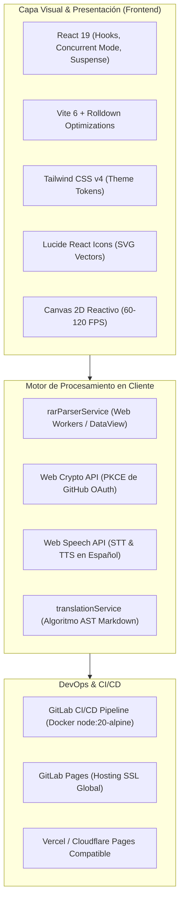

# 🧠 Códice Studio · Ecosistema Neuronal IA

[](https://react.dev/)
[](https://www.typescriptlang.org/)
[](https://vitejs.dev/)
[](https://tailwindcss.com/)
[](https://gitlab.com/SuarezCaceres/ai-skills-studio/-/pipelines)
[](https://ai-skills-studio-3ce497.gitlab.io)

> **Estación de ingeniería interactiva y suite de observabilidad para agentes autónomos y skills de IA.**
> Procesa paquetes `.rar` binarios en memoria sin servidor, ejecuta benchmarking en tiempo real de 7 modelos fundacionales (Claude Opus 5.5, Gemini 3.8, GPT Astra), ofrece un catálogo de componentes interactivos UI/UX y sincroniza bidireccionalmente con la bóveda de **Obsidian**.

---

## 🌐 Despliegue en Vivo y Producción

* **URL Oficial en Producción (GitLab Pages):**  
  👉 **[https://ai-skills-studio-3ce497.gitlab.io](https://ai-skills-studio-3ce497.gitlab.io)**
* **Redirección Canónica:**  
  👉 **[https://suarezcaceres.gitlab.io/ai-skills-studio](https://suarezcaceres.gitlab.io/ai-skills-studio)**

---

## 📌 ¿De qué trata el proyecto?

**Códice Studio** resuelve la necesidad de auditar, editar, probar y sincronizar *skills* y agentes de inteligencia artificial dentro de un entorno visual de alta fidelidad, rápido y completamente seguro:

1. **Inspección Binaria de Archivos `.RAR` en el Navegador (*Client-Side Engine*):**
   - Descomprime y analiza en memoria encabezados de paquetes RAR4 y RAR5 mediante Web Workers y Typed Arrays (`ArrayBuffer`, `DataView`), sin necesidad de enviar archivos pesados a un backend externo.
   - Genera árboles de archivos interactivos, visualiza código fuente en tiempo real y calcula métricas de lenguajes (`computeLanguageBreakdown`).
2. **Benchmarking & Telemetría de Modelos Fundacionales:**
   - Compara las 7 versiones líderes de IA en razonamiento profundo, velocidad de inferencia (`tok/s`), latencia de respuesta (`ms`) y fidelidad multimodal:
     - **Claude Opus 5.5 / 4.8** (Anthropic · Cortex Supremo · 99.4% precisión)
     - **Gemini 3.8 / 3.7 Live** (Google DeepMind · 178 tok/s · Contexto multimodal)
     - **Claude Sonnet 5.5** (Anthropic · Agentes reflexivos)
     - **GPT Astra / Luna** (OpenAI · Inferencia visual)
3. **Catálogo UI/UX Pro Max en Vivo:**
   - Sandbox interactivo con menús de barras accesibles (`menubar`), menús desplegables (`dropdown`), paletas de comandos (`command-palette`) y barras de herramientas dinámicas con soporte completo de teclado.
4. **Sincronización Bidireccional con Obsidian:**
   - Cada skill creada o modificada se vincula directamente con notas `.md` locales y con el grafo de conocimiento mediante el protocolo nativo `obsidian://open?vault=ai-skills-studio`.
5. **Evaluación de Accesibilidad por Voz (Web Speech API):**
   - Transcripción en tiempo real y síntesis de voz en español para interactuar con las directivas de las skills y componentes.

---

## 🎨 Dirección de Arte: Cyber Dark Espacial (UI/UX Pro Max)

El proyecto cuenta con un sistema de diseño propio inspirado en plataformas como **Linear**, **Vercel** y **Raycast**, diseñado para eliminar la fatiga visual en sesiones prolongadas de ingeniería:

* **Atmósfera Base:** Azul noche profundo (`#030712`) y morado espacial (`#0B081B`), con nebulosas de luz difuminadas (`blur-[140px]`) y una cuadrícula de precisión técnica con red neuronal viva en Canvas 2D (60–120 FPS).
* **Superficies Glassmorphic:** Paneles oscuros translúcidos (`#0B0F19/80`) con micro-bordes en morado tenue (`border-violet-900/30`) que reaccionan al hover con resplandor cian neón.
* **Paleta Oficial (Cero Naranja):**
  * **Color Primario / CTAs:** **Cian Eléctrico Neón (`#0EA5E9` / `#38BDF8`)** en botones principales, pestañas activas y anillos de foco.
  * **Color de Apoyo / Estados:** **Verde Esmeralda Suave (`#34D399`)** estrictamente reservado para badges de estado (*"Live Sync"*, *"Activo"* y checks de validación).
  * **Jerarquía Tipográfica:** Títulos en **Blanco Puro (`#FFFFFF`)**, descripciones en **Gris Azulado Claro (`#94A3B8`)** y titulares destacados con degradado suave de cian a violeta (`from-[#38BDF8] via-[#0EA5E9] to-[#C084FC]`).

---

## 🛠️ Tecnologías y Arquitectura



### Detalle de Tecnologías:

| Categoría | Tecnología | Propósito en el Proyecto |
| :--- | :--- | :--- |
| **Framework UI** | `React 19.0.0` | Arquitectura basada en componentes funcionales, `React.lazy` y `<Suspense>` para división de código (*code-splitting*). |
| **Lenguaje** | `TypeScript 5.7.2` | Tipado estricto con *Type Guards* en tiempo de ejecución para validación de estructuras en `localStorage`. |
| **Bundler & Dev** | `Vite 6.2.0` | Servidor de desarrollo ultrarrápido con HMR (`< 400ms`) y compilación para producción en `~2.0s`. |
| **Estilos** | `Tailwind CSS 4.0.9` | Directivas `@theme`, variables semánticas, animaciones fluidas y clases de utilidad. |
| **Iconografía** | `lucide-react 0.475.0` | Iconos vectoriales consistentes sin emojis para controles técnicos. |
| **Criptografía** | `Web Crypto API (Subtle)` | `SHA-256` para el desafío PKCE del inicio de sesión con GitHub. No hay contraseñas ni cuentas locales. |
| **Audio** | `Web Speech API` | Transcripción por voz (`webkitSpeechRecognition`) y síntesis de voz en tiempo real. |
| **CI/CD** | `GitLab CI/CD` | Pipeline automatizado con caché de dependencias `.npm` y compilación en runner Alpine Linux. |

---

## 🛡️ Seguridad y Calidad de Código (Hardening)

El proyecto implementa las directivas de seguridad **STRIDE** y revisión de **5 Ejes de Calidad**:

* **SEC-01 (Identidad con GitHub):** No existen contraseñas ni cuentas locales. El login es OAuth con PKCE y un `state` de un solo uso; el client secret vive solo en la función serverless de Vercel.
* **SEC-02 (Límite de peticiones):** El catálogo cachea las lecturas y reutiliza la caché si GitHub aplica su límite; con sesión usa el límite de 5000/h de la persona.
* **SEC-03 (Anti-Path Traversal & DoS):** Validación estricta de nombres de archivo dentro del `.rar` neutralizando secuencias `../` y limitando el tamaño a 25 MB.
* **SEC-04 (Token solo en memoria):** El token de GitHub no se guarda en `localStorage`, `sessionStorage` ni cookies, y hay un borrado completo de datos locales y copias de trabajo (GDPR).
* **SEC-05 (CSP Strict):** Cabeceras `Content-Security-Policy`, `X-Content-Type-Options: nosniff` y `X-Frame-Options: DENY`.
* **CR-04 (Performance Bundle):** División de módulos con carga diferida (`React.lazy`), manteniendo el paquete principal en menos de 350 kB.

---

## 🌐 Catálogo Comunitario de Skills

Cualquier persona con cuenta de GitHub puede registrar una skill pegando la URL de su repo, votarla y reportar con qué modelo de IA funcionó. Cada skill muestra un auditor automático (scripts, `curl | sh`, rutas sensibles), el comando de instalación para Claude Code, Cursor y Gemini CLI fijado al commit auditado, y un botón que traduce el contenido al español.

- Datos: Issues y reacciones de un repo catálogo en GitHub; login con OAuth mediante una función en Vercel (`api/github-oauth.ts`). El token solo vive en memoria.
- Subir una skill: pegando la URL de un repo con `SKILL.md`, o desde tu equipo (un `.md` o una carpeta). En el segundo caso la app la sube en un único commit a `<tu-login>/codice-skills` (repo público que crea si no existe), revisa que no haya claves o tokens y la registra en el catálogo. Volver a subir la misma skill actualiza el commit y borra los archivos que ya no están. También se puede **escribir la skill en la propia app** (nombre, descripción y contenido con vista previa) y **editar el `SKILL.md` de una skill propia** con un commit a GitHub; si alguien la editó por fuera, la app avisa del conflicto en vez de pisarla. Cada integrante tiene una **página de perfil** con sus datos de GitHub, números y skills.
- Puesta en marcha (repo catálogo, OAuth App, Vercel y variables `VITE_*`): [`docs/catalog-setup.md`](docs/catalog-setup.md).
- Pruebas: `npm test` incluye `scripts/test-catalog-integration.mjs`, que recorre el flujo en un navegador real con GitHub simulado.

## 🧩 Componentes y Clases

- **Componentes:** el kit del equipo vive en `src/components/ui-kit/` (20 componentes propios, sin código ni imágenes de terceros). La página lista los componentes en una barra lateral con buscador y filtros (Todos, Con skill, Con modelo, No asignados, y categoría). Cada uno muestra su vista previa en vivo, una captura generada a partir del propio componente, su código real (importado con `?raw`), notas de accesibilidad y la skill o el modelo de IA asignado; si no tiene, dice **No asignado**.
- **Asignar** una skill del equipo o un modelo requiere sesión de GitHub y se guarda en `localStorage` (`ai_skills_studio_component_assignments_v1`). Ver es libre.
- **Añadir un componente:** crea `src/components/ui-kit/<Nombre>.tsx` con un `export function Demo()`, añade una entrada a `src/data/componentRegistry.ts` y ejecuta `node scripts/capture-components.mjs` para generar su miniatura (`public/components/<id>.png`, ≤ 40 KB).
- **Clases:** en Códice → *Clases* se suben explicaciones de lo que se ha hecho en el equipo (Markdown con vista previa en vivo, nivel, etiquetas y la skill y los componentes usados). Solo quien la subió puede editarla o borrarla. Por ahora se guardan en el navegador (`ai_skills_studio_lessons_v1`) y se pueden **exportar e importar como JSON**; compartirlas por GitHub queda pendiente. Desde un componente se ven las clases que lo mencionan.
- Pruebas: `npm test` incluye `test-lessons-store.mjs`, `test-component-assignments.mjs`, `test-components-page.mjs`, `test-components-assign.mjs` y `test-lessons.mjs` (GitHub y OAuth simulados; nunca se toca `api.github.com`).

---

## 🌿 Estrategia de Ramas en Git

El repositorio sigue un flujo estructurado de dos ramas para garantizar estabilidad en producción:

| Rama | Propósito | Despliegue Automático | Acceso |
| :--- | :--- | :---: | :--- |
| **`main`** | **Rama Oficial de Producción.** Contiene el código estable y probado. | ✅ **Sí** (Despliega en GitLab Pages) | Protegida |
| **`testing`** | **Rama de Pruebas y Experimentación.** Aquí se integran nuevas funciones antes de ir a producción. | ❌ No afecta producción | Libre para pruebas |

### Flujo de Trabajo Recomendado:

```bash
# 1. Posicionarse en la rama de pruebas para realizar experimentos
git checkout testing

# 2. Realizar cambios y probar localmente
npm run dev

# 3. Compilar para verificar que no hay errores de TypeScript
npm run build

# 4. Guardar los cambios en la rama de pruebas
git add .
git commit -m "feat(modulo): descripcion del experimento"
git push origin testing

# 5. Cuando las pruebas sean satisfactorias, integrar a main para publicar
git checkout main
git merge testing
git push origin main
```

---

## 💻 Instalación y Ejecución Local

### Prerrequisitos:
* **Node.js:** Versión 20.x o superior.
* **NPM:** Versión 10.x o superior.

```bash
# 1. Clonar el repositorio
git clone https://gitlab.com/SuarezCaceres/ai-skills-studio.git
cd ai-skills-studio

# 2. Instalar dependencias
npm install

# 3. Iniciar el servidor de desarrollo
npm run dev
# Acceder en: http://localhost:5173/

# 4. Compilar para producción (validación de TypeScript + Vite)
npm run build

# 5. Previsualizar la compilación de producción localmente
npm run preview
```

---

## 📁 Estructura del Proyecto

```text
ai-skills-studio/
├── .gitlab-ci.yml             # Pipeline de CI/CD para GitLab Pages
├── .gitignore                 # Reglas de exclusión (node_modules, dist, etc.)
├── Códice Neuronal - MOC.md   # Mapa de conocimiento para Obsidian (MOC)
├── package.json               # Dependencias y scripts de construcción
├── tsconfig.json              # Configuración del compilador TypeScript
├── vite.config.ts             # Configuración de Vite, plugins y cabeceras CSP
├── index.html                 # Punto de entrada HTML con CSP y metaetiquetas
├── src/
│   ├── App.tsx                # Orquestador principal, rutas y suspense
│   ├── main.tsx               # Montaje en el DOM
│   ├── index.css              # Variables de tema Cyber Dark y animaciones
│   ├── components/            # Componentes visuales y módulos funcionales
│   │   ├── AIModelBenchmarkPanel.tsx    # Comparador y radar de los 7 modelos IA
│   │   ├── AuthScreen.tsx               # Acceso: visitante o entrar con GitHub
│   │   ├── BrandIcons.tsx               # SVGs oficiales temáticos (Claude, Gemini, GPT)
│   │   ├── CodiceStudio.tsx             # Suite Cyber Dark de alta densidad
│   │   ├── ContextEvidenceLogger.tsx     # Galería visual de capturas y evidencias
│   │   ├── InformativeLandingSection.tsx # Página de inicio y selector de modelos
│   │   ├── MarkdownViewerTranslator.tsx  # Visor y traductor de Markdown
│   │   ├── NavbarActiveSkill.tsx         # Barra de navegación flotante y drawer
│   │   ├── NeuralAtmosphereBackground.tsx# Canvas 2D con red neuronal reactiva
│   │   ├── RarArchiveExplorer.tsx        # Explorador y visor de archivos .RAR
│   │   ├── catalog/                      # Catálogo, equipo, detalle, auditor, instalación y traducción
│   │   ├── studio/                       # Barra de skill activa y estado vacío de los módulos
│   │   ├── StylePresetCatalog.tsx        # Catálogo de componentes y presets
│   │   ├── components/                   # Página Componentes: lista lateral, detalle, asignación y miniaturas
│   │   ├── lessons/                      # Pestaña Clases de Códice: lista, detalle, editor y selectores
│   │   ├── ui-kit/                       # 20 componentes reales (React + Tailwind), cada uno con su Demo
│   │   ├── UnifiedProjectStudio.tsx      # Inspector unificado de proyectos
│   │   └── VoiceVisualFeedback.tsx       # Reconocimiento y síntesis por voz
│   ├── data/                  # Catálogos estáticos y colecciones de datos
│   │   ├── aiModelsData.ts               # Métricas de los modelos de IA
│   │   ├── componentRegistry.ts          # Registro del kit: id, categoría, accesibilidad, demo y código
│   │   ├── frameworkCollectionsData.tsx  # Colecciones de frameworks y píldoras
│   │   └── stylePresets.ts               # Presets de componentes UI/UX
│   ├── services/              # Lógica de procesamiento y servicios
│   │   ├── componentAssignments.ts       # Skills y modelos de IA asignados a cada componente (local)
│   │   ├── lessonsStore.ts               # Almacén de clases con validación, importar y exportar
│   │   ├── rarParserService.ts           # Descompresor binario de paquetes .RAR
│   │   ├── speechService.ts              # Servicio de voz Web Speech API
│   │   └── translationService.ts         # Traducción algorítmica de Markdown
│   ├── types/                 # Definiciones de tipos TypeScript
│   │   ├── skill.ts                      # Interfaces de skills y componentes
│   │   └── workspace.ts                  # Rutas, modelos y cuentas de usuario
│   └── utils/                 # Utilidades de seguridad y validación
│       ├── securityHardening.ts          # Sanitización, anti-traversal y borrado de datos
│       └── workingCopy.ts                # Copias de trabajo de las skills del equipo
```

---

## 📄 Licencia

Este proyecto está disponible para fines educativos y de investigación en ingeniería de IA.
Desarrollado y mantenido por **Sergio Suarez** ([@SuarezCaceres](https://gitlab.com/SuarezCaceres)).
